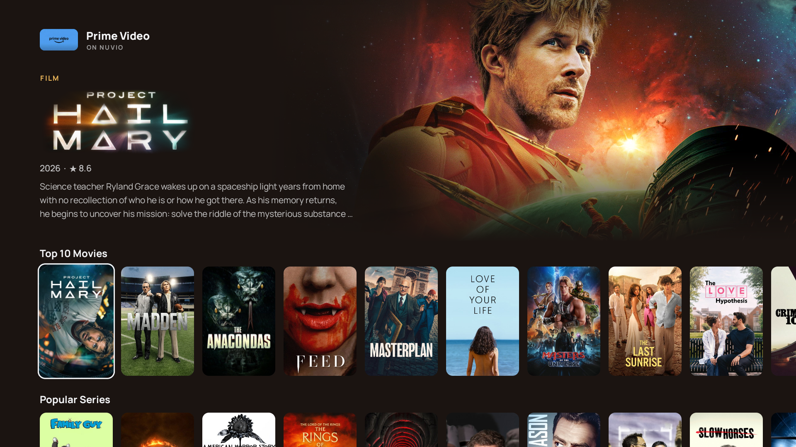

# beacon

An ad-free home screen for Android TV / Google TV / projectors, built around **Nuvio**, with a full **Live TV guide**, a Veil-style menu and a drifting-artwork screensaver. It also includes a Nuvio setup, speed tweaks, and a runbook so **Claude sets it all up for you**.

beacon is a fork of **Horizon Home Kit** by jyotiprakash101 (MIT), reworked and renamed. The original was built on an XGIMI Horizon S Max (Android TV 11, 1.7 GB RAM); beacon should work on any Android TV 8+ box or projector, and is used on an NVIDIA Shield.

> The first image is beacon itself. **Most of the other images and the demo video are from the original Horizon Home Kit.** beacon keeps the same layout, but the top bar, menu, focus style and screensaver look different now.

▶️ **[Watch the original Horizon demo video](screenshots/horizon-demo.mp4)**

| | |
|---|---|
|  Netflix page, powered by Nuvio |  Prime Video page |
|  Live TV guide with live preview |  Pick a country |
|  Category filter |  Language filter |
|  See-through guide while watching |  Nuvio home with the kit's layout |
|  Nuvio Discover collection |  Nuvio Streaming Services collection |

## What's new in beacon (compared with Horizon Home Kit)

**Name and build**
- **A "beacon" shortcut in the app list** (with the new icon and banner) that opens the home screen, next to "beacon settings".
- Renamed from Horizon to **beacon** everywhere you can see it: the top-left pill, menus, launcher and screensaver labels, the Home-button accessibility service, the APK (`BeaconHome.apk`) and the Windows scripts (`install-beacon.bat`, `update-beacon.bat`, `use-beacon-home.bat`, `uninstall-beacon.bat`).
- beacon has its own app id, `com.beacon.home`, so it installs **next to** an existing Horizon instead of replacing it. It starts fresh, so you'll need to pick beacon as the home app and set it up again; you can uninstall Horizon whenever you like. Live TV guide links work with both `beacon://guide` and the old `horizon://guide`.
- GitHub Actions builds with `bash launcher/build.sh` (the script no longer needs its execute bit) and numbers each build from the run number.

**Top bar and menu**
- The top-left pill opens a **Veil-style dropdown menu**:
  - **Start screensaver**: preview it right now (any key leaves).
  - **Screensaver starts after**: Off, 1, 3, 5, 10 or 20 minutes.
  - **Theme** colour bubbles, a **Colours from artwork** toggle, **Focus style** (Glow or Fill) and **Title artwork**.
  - **Sound**: navigation sounds on/off and an 8-step volume.
  - **Weather** toggle and **Weather location**: search for a city by name, or go back to automatic.
  - **Use as Android TV screensaver**: jumps to the system screensaver picker.
  - **More settings**: the full settings screen.
- The **clock is centered with the weather beside it**, in **Fahrenheit**.
- The ad-blocking (NextDNS) pill and the free-memory pill are gone from the top bar, and **all ad-blocking features have been removed from beacon** (the NextDNS code, its settings entry and the `ad-block-on/off` scripts). HDMI, Wi-Fi and settings buttons remain on the right.

**Screensaver**
- One Veil-style ambient screen is used both for Home's idle mode and as a real **Android TV screensaver** (a system `DreamService`).
- It drifts slowly across artwork, cross-fades between titles and shows the title (or its logo), where it came from ("Continue watching", or the row name such as "Netflix · Top Series"), an episode or year line, the clock and the weather.
- It mixes **Continue Watching, Nuvio's own rows and titles from five random streaming services' lists**, shuffled. Hidden services are skipped.
- Episodes use the **series' wallpaper** instead of the episode still.

**Home screen behaviour**
- **Left and Right stop at the end of a row** instead of jumping to another row.
- **Pressing Home while already on Home** selects the first pinned app.
- **Down on the bottom row opens All apps**. The All apps button only appears when nothing is pinned.
- **Pins work like Veil**: *Pin to Home* adds to the end of the row; long-press a pinned app for **Open, Rearrange, Unpin**. *Rearrange* lifts the app: Left/Right move it, OK places it, Back cancels.
- **All apps is one alphabetical list**, with a small pin badge on apps that are pinned to Home.
- **Each row remembers your place** when you move Up and Down between rows.
- The long-press menu uses a Veil-style action sheet.
- **Streaming tiles** can be **rearranged** the same way, and **hidden** (long-press → *Hide from Home*). Once any are hidden, a blank tile with a **+** at the end of the row lists them so you can add them back (one at a time or *Add all*).
- **Continue Watching refreshes right away when you switch profiles in Nuvio**, without opening Nuvio again. When most of the list is replaced (a profile switch), the row slides in fresh from its first item, the heading flashes in the accent colour and a short "Continue watching updated" message appears.
- **Title artwork instead of text.** The focused show or movie's title graphic (its logo) replaces the plain-text title when one can be found. It's looked up by name, with a strict match so a similar title never shows the wrong art, and falls back to text. Turn it off with *Title artwork* in the menu.
- **Focus glow.** The item you've selected gets a ring and a soft outward glow in your theme colour instead of filling solid white. *Focus style* in the menu switches between **Glow** and the original **Fill**.
- **Navigation sounds**, ported from Veil: soft synthesised tones (no audio files) for moving, selecting, going back and toggles. The beacon menu has a **Sound** section with an on/off toggle and an 8-step volume (Left/Right to change it).
- **Episode wallpapers use the series artwork**, not the episode still.
- **Long titles shrink to fit on one row** instead of wrapping or being cut off.
- **Smoother artwork**: a new picture starts where the old one is, so it no longer re-zooms; a double-darkening glitch that dimmed the picture for a moment is fixed.

## What's inside

**beacon** (`launcher/`): a home screen app.
- **No ads or promoted rows.** It opens on what you were watching, with a big artwork backdrop.
- **Continue watching** from Nuvio (read from Android TV's Watch Next / Preview programs), with time left and "done by 10:32 PM".
- **Streaming services** row (Netflix, Prime Video, Apple TV, Hulu, AMC+, Crave…). Each opens a Nuvio-powered page: big title art, then the service's Top 10 and its popular and new movies and series. Picking a title opens it in Nuvio.
- **Your apps** row, pinned in the order you choose, plus All apps.
- **📺 Live TV guide**, TiviMate-style:
  - Big live preview at the top; filter by country, category, language and source.
  - Full screen with channel up/down and a see-through guide.
  - Favourites, and "Open in Nuvio".
  - Picks the sharpest version of each stream (up to 1080p).
- **Settings on the TV itself** (no PC needed): animation speed, Google TV recommendations, power button, and the home screen switch. Each change has an undo.
- **Switch back to the Google TV home any time** from beacon's settings on the TV (or `use-original-home.bat` from the PC), and back to beacon again.
- The remote's **Home button** always brings you to beacon.

**Live TV addon** (`livetv-addon/`): a Nuvio/Stremio addon you host free on Cloudflare.
- About 15,500 channels in 180 countries; about 7,500 have a TV guide.
- Sources: iptv-org, a validated list, Free-TV, Samsung TV Plus, Pluto TV and Roku Channel.
- Every link is test-played every 3 hours; working and sharpest links come first.
- Rows: On now, Starting soon, Tonight. Each channel page shows its schedule.
- Also gives a playlist + guide link for TiviMate / OTT Navigator.

**Nuvio setup** (`nuvio/`): an addon list in order (no keys), and a Home layout template (5 collections, 58 folders: Discover, Streaming Services with Netflix/Prime/Apple TV/Hulu…, Genres, Anime, Formats).

**Windows scripts** (`windows/`): install, update, switch back, speed tweaks, XGIMI power button. Every script backs up the original setting first and has an undo.

## Using the screensaver

- **Preview or in-app idle mode:** open the beacon menu (top-left pill) → *Start screensaver*. *Screensaver starts after* sets how long Home sits idle before it begins on its own.
- **As the Android TV screensaver:** Settings → Device Preferences → Screen saver → choose **beacon**. If your device doesn't list it, run:
  `adb shell settings put secure screensaver_components com.beacon.home/com.horizon.home.BeaconDream`
- The system screensaver's own start time is set in Android's Screen saver settings (*When to start*). The menu's timer only controls beacon's in-app idle mode.
- If you used the earlier Horizon build as your screensaver, choose beacon again once.
- Set the weather city in the menu first so the screensaver can show the temperature.
