
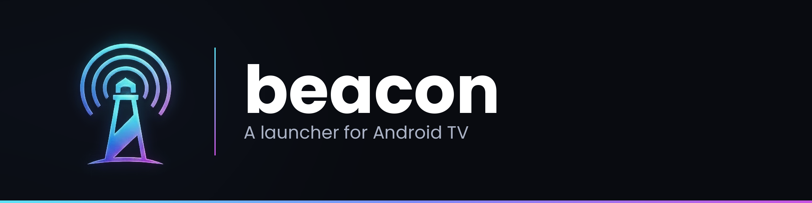

# beacon: an Android TV home built around Nuvio

An ad-free home screen for Android TV, Google TV and projectors, built around **Nuvio**. Switch Nuvio profiles right from the home screen and your Continue watching feed updates instantly. It also brings **Live TV channels** with a full guide, and one-press **streaming services**, each with its own page. And it's easy to set up, with deep appearance customization.

It runs on any Android TV 8+ box or projector and is used daily on an NVIDIA Shield. Builds are installed and updated straight from this repo's Releases.

beacon is a fork of **Horizon Home Kit** by jyotiprakash101 (MIT), reworked and renamed, with several features incorporated from **Veil**.

*Home: your Continue watching row with the title's own artwork behind it, streaming services below, and your pinned apps in the dock.*

## A look around

| | |
|---|---|
| 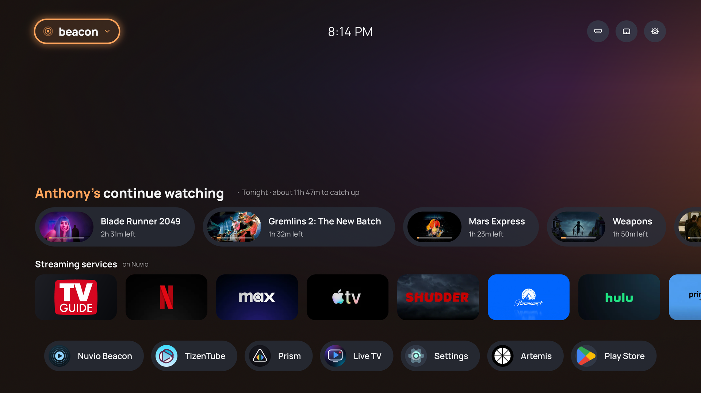 *Continue watching as wide pills, with the dock in its Pill style.* | 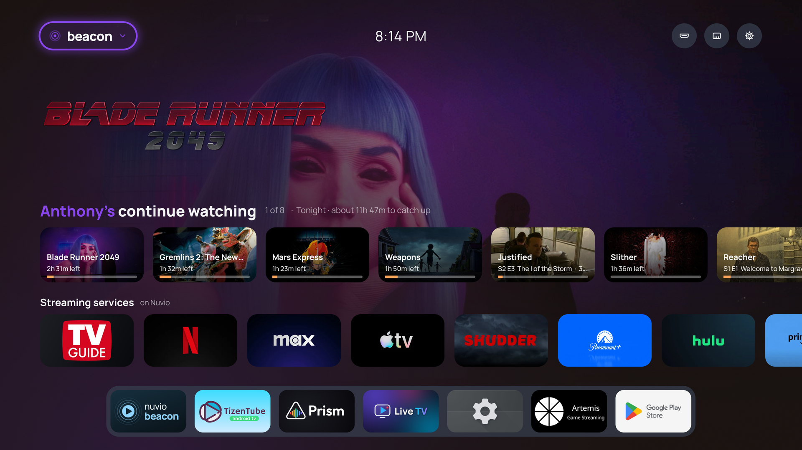 *Poster cards with a progress bar, and the dock as banner cards.* |
| 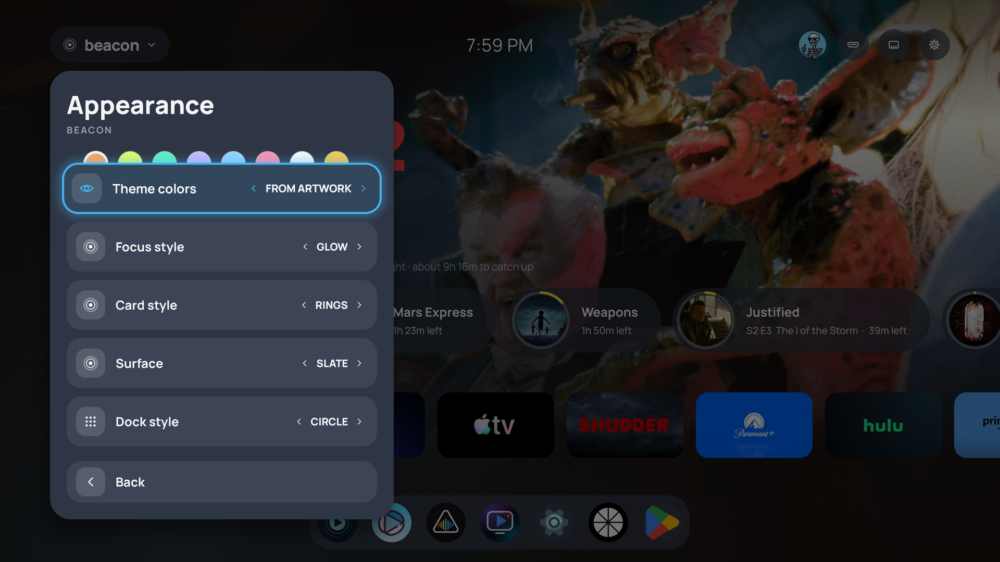 *Appearance: theme colours (follow Nuvio, from artwork, or pick one), focus, card, surface and dock styles.* | 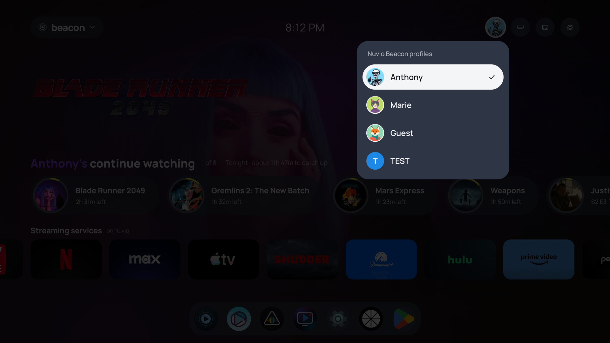 *Switch Nuvio profiles from the top bar. Continue watching changes with the profile.* |
| 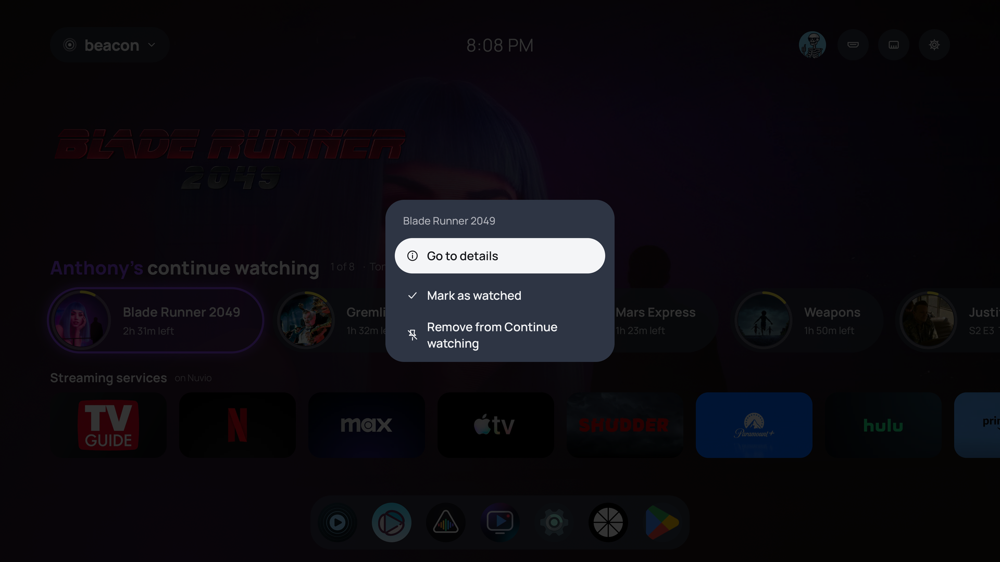 *Long-press a Continue watching item: go to details, mark as watched or remove it.* | 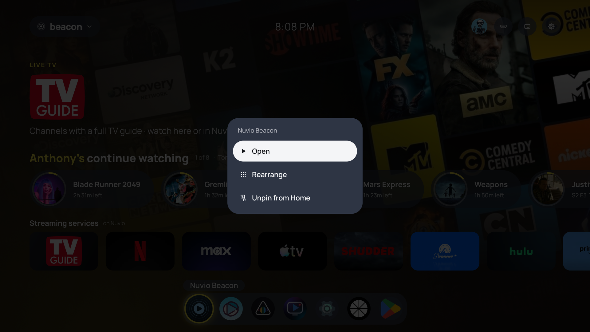 *Long-press an app: open it, rearrange the dock or unpin it.* |
| 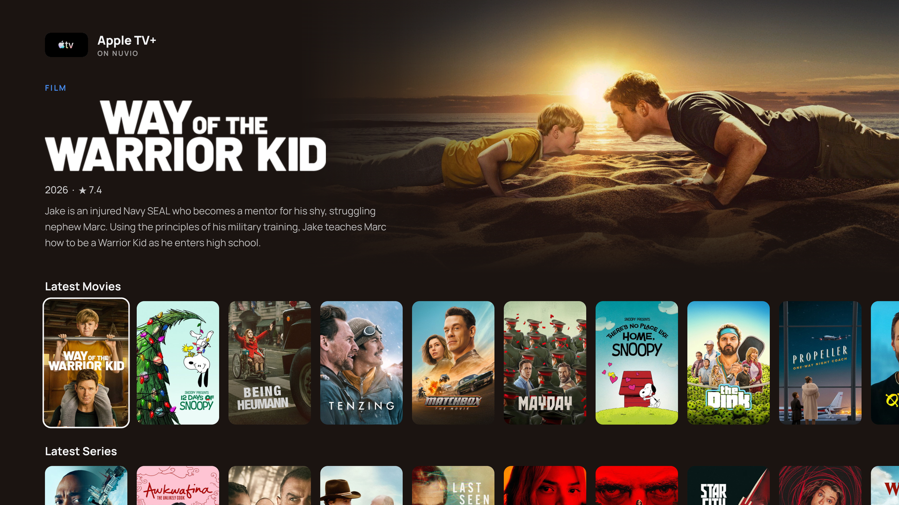 *Every streaming service has its own Nuvio-powered page.* | 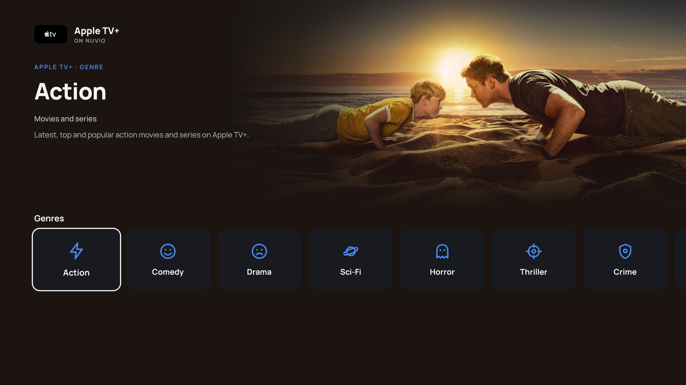 *Jump into a service by genre.* |
| 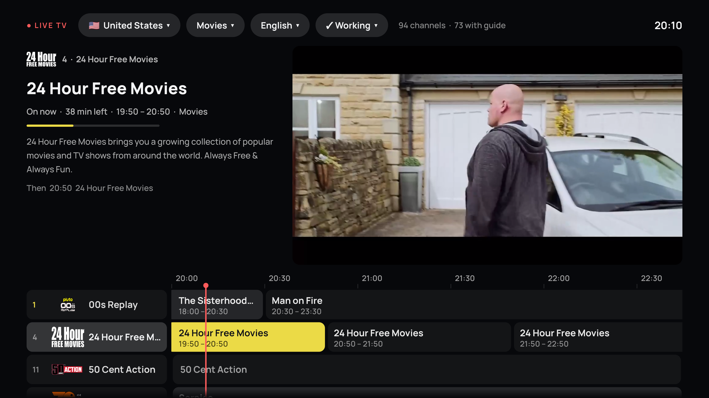 *The Live TV guide: live preview on top, schedule below.* | 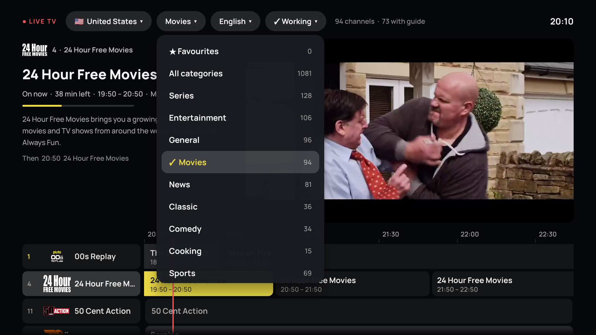 *Filter channels by country, category, language and whether they work.* |
| 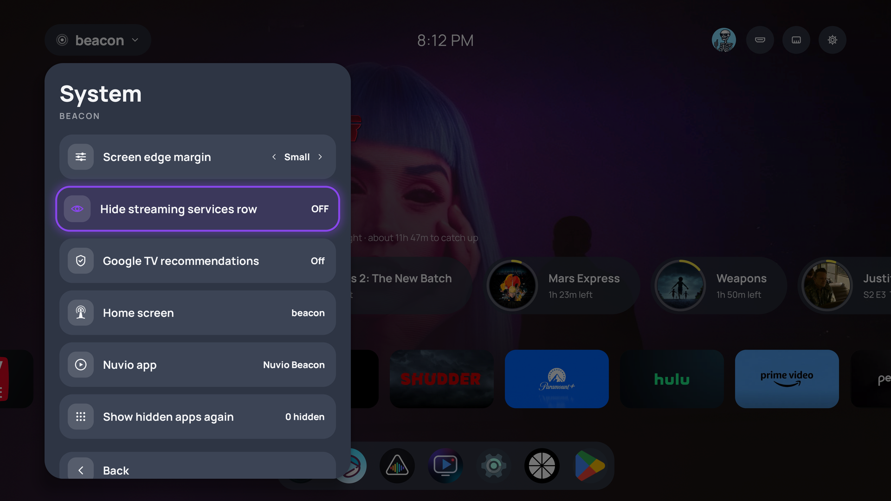 *System settings, including hiding the streaming services row.* | 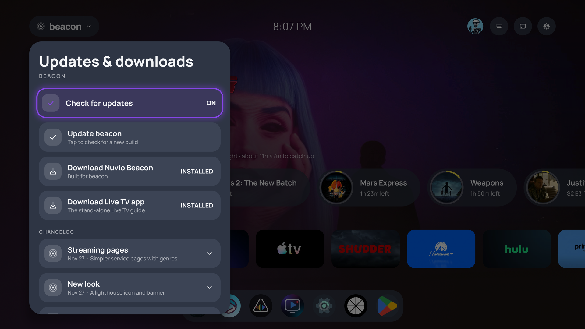 *Updates and downloads, with a changelog, all from the TV.* |

## Installation

1. Open this repo's **Releases** page and download **`BeaconHome.apk`** from the newest release (under *Assets*).
2. Install it on your TV, either way:
   - **On the TV:** copy the APK over (USB stick, the *Downloader* app, or a file manager) and open it. Allow *Install unknown apps* if Android asks.
   - **From a PC:** `adb install -r BeaconHome.apk`, or put the APK in the `windows` folder and run `install-beacon.bat`. New to the scripts? See the [Windows scripts guide](windows/USING-THE-SCRIPTS.md).
3. Open **beacon** from your app list. To make it the home screen, open the beacon menu → *System → Home screen* (or run `windows/use-beacon-home.bat`; [step-by-step guide](windows/USING-THE-SCRIPTS.md)).

Needs Android TV / Google TV 8 or newer. Install the Android TV build of Nuvio too if you want *Continue watching* (or a Nuvio fork, then pick it in *System → Nuvio app*).

## Updating

beacon updates itself from this repo's Releases:

- Open the beacon menu (top-left pill) → **Updates → Update beacon**, or select the **Update available** pill on Home, which opens the same page and checks right away. It checks GitHub and shows whether you're up to date; if a newer build exists, press it again to download and install it, then confirm Android's install prompt. The first time, Android may ask you to allow installs from beacon (*Settings → Apps → Special app access → Install unknown apps*).
- With **Check for updates** switched on (the default), beacon checks about twice a day and shows a small notice on Home when a new build is out.
- After the install finishes beacon reopens by itself. For that to work on every update, run `install-beacon.bat` or `update-beacon.bat` once from a PC, which also grants the permission it needs. Every build is published as its own numbered release (for example `v3.3.108`), and the build number is shown under *Updates → About*. You can always download an APK from Releases by hand instead.

## Features

**Home**
- **Continue watching** from Nuvio, with time left and "done by" time, in three looks: pills, rings (the default) or poster cards. Long-press an item for **Go to details, Start from beginning, Mark as watched** or **Remove**. These actions need [Nuvio Beacon](https://github.com/antgash/NuvioTVbeacon/blob/beacon/BEACON.md).
- **Title artwork** (the logo) instead of plain text for the focused show or movie, with the picture behind it.
- **Streaming services** row (Netflix, Prime Video, Apple TV, Hulu, Max, Paramount+ and more) plus a Live TV tile. Each service opens a Nuvio-powered page with its Top 10, popular and new titles, and genres. Rearrange or hide tiles, and add them back from the **+** tile. You can also hide the whole row in *System*.
- **Your apps** in a dock you can pin to (up to 10) in three styles: Pill, Circle or Cards. Long-press for Open, Rearrange or Unpin. Down on the dock opens **All apps**, which updates as soon as you uninstall something.
- **Nuvio profile button** in the top bar to switch profiles. It works with Nuvio Beacon, which shares its profiles with launchers.
- Each row remembers your place, and Left and Right stop at the end of a row.

**Look and feel**
- **Theme colours:** follow the active Nuvio profile's accent, take the colour from the artwork on screen, or choose your own.
- Frosted glass, Smoke or Slate surfaces, Glow or Fill focus, a small, medium or large screen margin, navigation sounds, and the clock with the weather beside it.

**Live TV guide**
- Big live preview, filters for country, category, language and source, favourites, a see-through guide while watching, and "Open in Nuvio". It picks the sharpest version of each stream. Needs the Live TV addon below, or install the stand-alone **Live TV** app from *Updates & downloads*.

**Screensaver**
- A drifting-artwork screen used both for Home's idle mode and as the real Android TV screensaver. It shuffles Continue watching, Nuvio's rows and titles from your streaming services, and press OK on any title to open its details in Nuvio and play it. See *Using the screensaver* below.

**Updates**
- *beacon menu → Updates & downloads* updates beacon, installs **Nuvio Beacon** and the **Live TV** app, and shows a changelog. beacon checks about twice a day and tells you on Home when a build is out.

## What's inside

**beacon** (`launcher/`): the home screen app.

**Live TV addon** (`livetv-addon/`): a Nuvio/Stremio addon you host free on Cloudflare.
- About 15,500 channels in 180 countries, about 7,500 with a TV guide, from iptv-org, Free-TV, Samsung TV Plus, Pluto TV and Roku Channel.
- Every link is test-played every 3 hours, working and sharpest links first. Rows for On now, Starting soon and Tonight. It also gives a playlist and guide link for TiviMate or OTT Navigator.

**Nuvio setup** (`nuvio/`): an addon list in order (no keys) and a Home layout template (5 collections, 58 folders: Discover, Streaming Services, Genres, Anime, Formats).

**Windows scripts** (`windows/`): install, update, switch home screens, speed tweaks. Every script backs up the original setting and has an undo. See the [Windows scripts guide](windows/USING-THE-SCRIPTS.md).

To give the streaming service pages more titles, add a free TMDB v3 API key as a repository secret named `TMDB_KEY` (optional; the build bakes it into the app).

## Differences from Horizon Home Kit

- Renamed to **beacon** everywhere, with its own app id (`com.beacon.home`), so it installs next to Horizon instead of replacing it. Live TV guide links work with `beacon://guide` and the old `horizon://guide`.
- New top bar and menu (Appearance, Screensaver, Sound, Weather, System, Updates & downloads), theme colours, three card styles and three dock styles, Nuvio profile switching, Continue watching actions, a built-in updater and a new Veil-style screensaver.
- All ad-blocking features (the NextDNS code, its settings and scripts) and the memory pill were removed.
- GitHub Actions builds with `bash launcher/build.sh` and publishes each build as its own numbered release (the newest 10 are kept).

## Using the screensaver

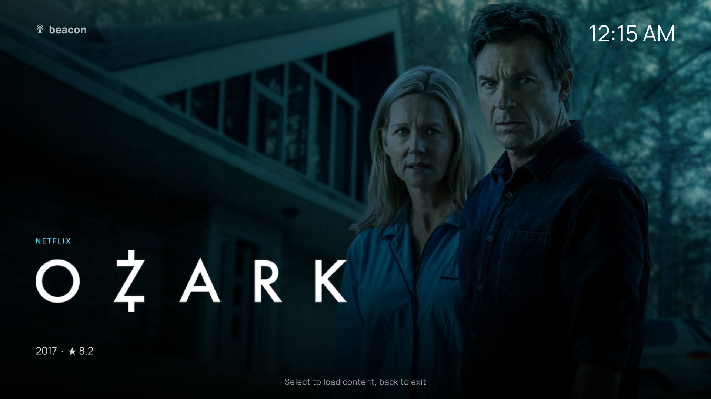
*The screensaver drifts across artwork from your Continue watching, Nuvio's rows and your streaming services. Press **OK / Select** on any title to open its details page in Nuvio, where you can play it.*

- **Preview or in-app idle mode:** open the beacon menu (top-left pill) → *Screensaver → Start screensaver*. *Screensaver starts after* sets how long Home sits idle before it begins on its own.
- **As the Android TV screensaver:** Settings → Device Preferences → Screen saver → choose **beacon**. If your device doesn't list it, run:
  `adb shell settings put secure screensaver_components com.beacon.home/com.beacon.home.BeaconDream`
- The system screensaver's own start time is set in Android's Screen saver settings (*When to start*). The *Screensaver starts after* setting only controls beacon's in-app idle mode.
- If you used the earlier Horizon build as your screensaver, choose beacon again once.
- Set the weather city in *Weather → Weather location* first so the screensaver can show the temperature.
