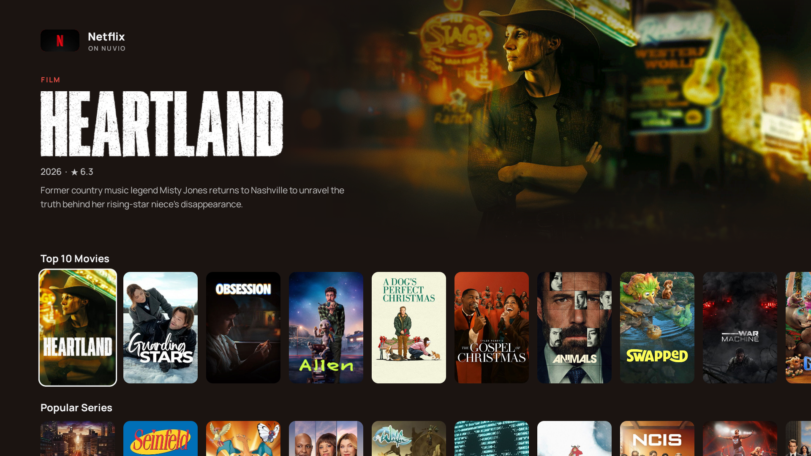
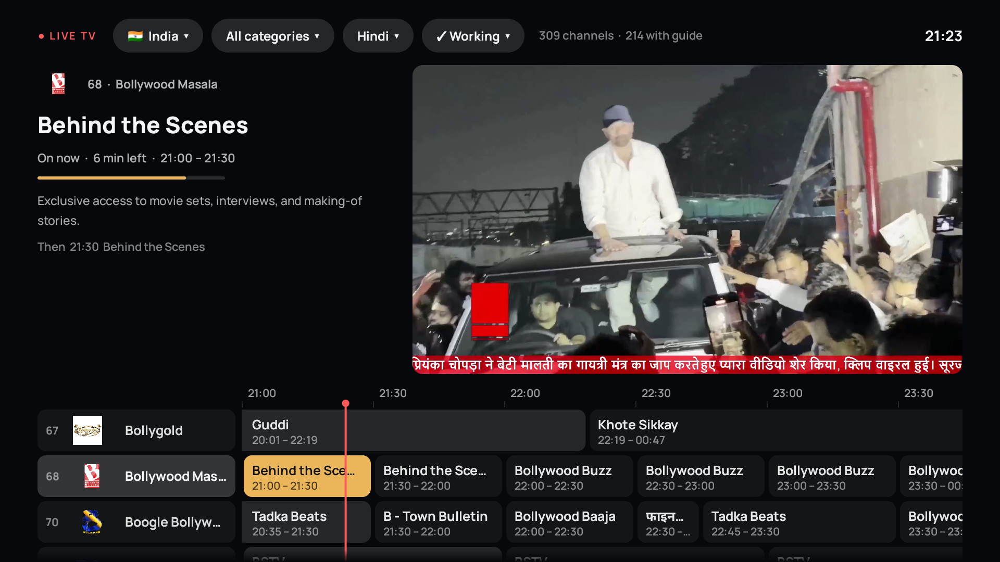
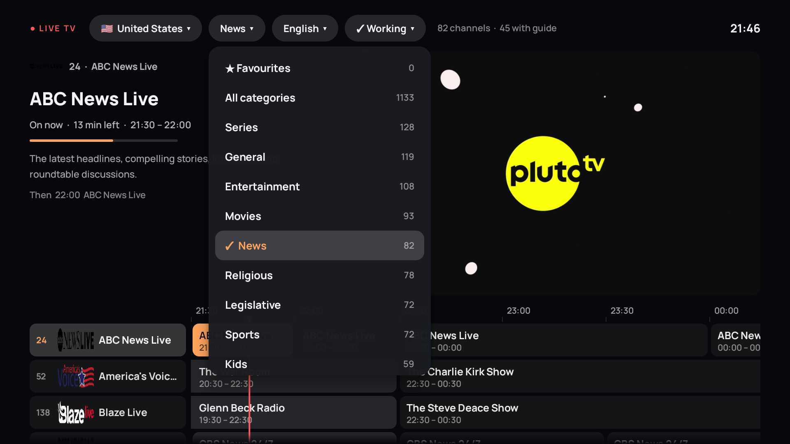
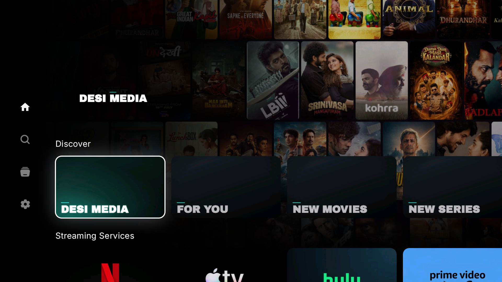
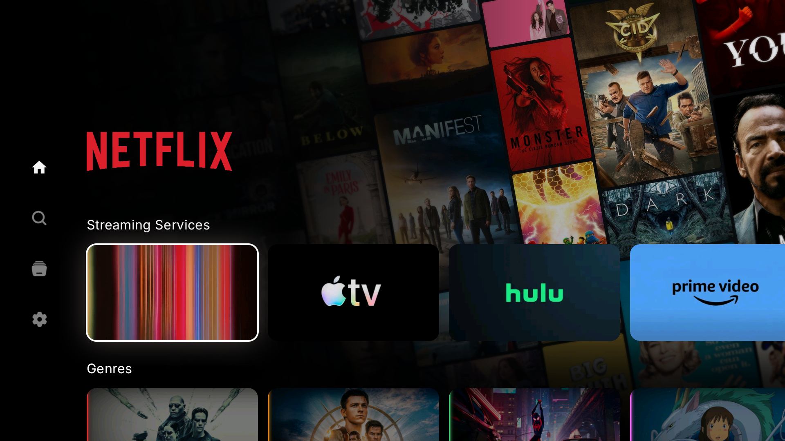

# beacon - Android TV Home built around Nuvio

An ad-free home screen for Android TV / Google TV / projectors, built around **Nuvio**, with a full **Live TV guide**, a Veil-style menu and a drifting-artwork screensaver. It also includes a Nuvio setup, speed tweaks, and a built-in updater that installs new builds straight from this repo's Releases.

beacon is a fork of **Horizon Home Kit** by jyotiprakash101 (MIT), reworked and renamed. The original was built for a low-memory Android TV 11 projector (1.7 GB RAM); beacon should work on any Android TV 8+ box or projector, and is used on an NVIDIA Shield.

> The first image is beacon itself. **Most of the other images and the demo video are from the original Horizon Home Kit.** beacon keeps the same layout, but the top bar, menu, focus style and screensaver look different now.

▶️ **[Watch the original Horizon demo video](screenshots/horizon-demo.mp4)**

| | |
|---|---|
|  Netflix page, powered by Nuvio |  Prime Video page |
|  Live TV guide with live preview |  Pick a country |
|  Category filter |  Language filter |
|  See-through guide while watching |  Nuvio home with the kit's layout |
|  Nuvio Discover collection |  Nuvio Streaming Services collection |

## Installation

1. Open this repo's **Releases** page and download **`BeaconHome.apk`** from the newest release (under *Assets*).
2. Install it on your TV, either way:
   - **On the TV:** copy the APK over (USB stick, the *Downloader* app, or a file manager) and open it. Allow *Install unknown apps* if Android asks.
   - **From a PC:** `adb install -r BeaconHome.apk`, or put the APK in the `windows` folder and run `install-beacon.bat`. New to the scripts? See the [Windows scripts guide](windows/USING-THE-SCRIPTS.md).
3. Open **beacon** from your app list. To make it the home screen, open the beacon menu → *System → Home screen* (or run `windows/use-beacon-home.bat`; [step-by-step guide](windows/USING-THE-SCRIPTS.md)).

Needs Android TV / Google TV 8 or newer. Install the Android TV build of Nuvio too if you want *Continue watching* (or a Nuvio fork, then pick it in *System → Nuvio app*).

## Updating

beacon updates itself from this repo's Releases:

- Open the beacon menu (top-left pill) → **Updates → Update beacon**, or select the **Update available** pill on Home, which opens the same page and checks right away. It checks GitHub and shows whether you're up to date; if a newer build exists, press it again to download and install it, then confirm Android's install prompt. The first time, Android may ask you to allow installs from beacon (*Settings → Apps → Special app access → Install unknown apps*).
- With **Check for updates** switched on (the default), beacon checks about twice a day and shows a small notice on Home when a new build is out.
- After the install finishes beacon reopens by itself. For that to work on every update, run `install-beacon.bat` or `update-beacon.bat` once from a PC, which also grants the permission it needs. Every build is published as its own numbered release (for example `v3.3.108`), and the build number is shown under *Updates → About*. You can always download an APK from Releases by hand instead.

## What's new in beacon (compared with Horizon Home Kit)

**Name and build**
- **A "beacon" shortcut in the app list** (with the new icon and banner) that opens the home screen.
- Renamed from Horizon to **beacon** everywhere you can see it: the top-left pill, menus, launcher and screensaver labels, the Home-button accessibility service, the APK (`BeaconHome.apk`) and the Windows scripts (`install-beacon.bat`, `update-beacon.bat`, `use-beacon-home.bat`, `uninstall-beacon.bat`).
- beacon has its own app id, `com.beacon.home`, so it installs **next to** an existing Horizon instead of replacing it. It starts fresh, so you'll need to pick beacon as the home app and set it up again; you can uninstall Horizon whenever you like. Live TV guide links work with both `beacon://guide` and the old `horizon://guide`.
- GitHub Actions builds with `bash launcher/build.sh`, numbers each build from the run number and publishes it as its own release (the newest 10 are kept).
- **Built-in updater**: *beacon menu → Updates* checks this repo's newest release, downloads it and hands it to Android's installer. It also checks about twice a day and tells you on Home. See *Updating* above.

**Top bar and menu**
- The top-left pill opens the **beacon menu**, a short list of categories. Select one to open its page, and Back returns to the list:
  - **Appearance**: theme colour bubbles, **Colours from artwork**, **Surface** (Frosted glass, Smoke or Slate, the last two semi-transparent), **Focus style** (Glow or Fill), **Dock style** (see below), **Card style** (see below) and **Title artwork**.
  - **Screensaver**: **Start screensaver** at the top (preview it right now; any key leaves), **Screensaver starts after** (Off, 1, 3, 5, 10 or 20 minutes), **Artwork changes every**, and **Use as Android TV screensaver** (jumps to the system screensaver picker).
  - **Sound**: navigation sounds on/off and an 8-step volume.
  - **Weather**: show it by the clock, and **Weather location** (search for a city by name, or go back to automatic).
  - **System**: **Screen edge margin**, **Animation speed**, **Google TV recommendations**, **Home screen** (beacon or Google TV), **Nuvio app**, **Nuvio connection** and **Show hidden apps again**.
  - **Updates & downloads**: automatic check on/off, **Update beacon**, **Download Nuvio Beacon** (built for beacon: downloads and installs it from GitHub when it isn't installed; it then updates itself), a **Changelog** of beacon's major revisions (select one to see its main changes) and **About** (version).
- **Nuvio profile button** next to the beacon pill: it shows the active Nuvio profile's picture, and Select lists every profile so you can switch. The switch happens in Nuvio too. Profiles with a PIN open Nuvio's own profile screen so the PIN is entered there. This needs a Nuvio that shares its profiles with launchers, which **[Nuvio Beacon](https://github.com/antgash/NuvioTVbeacon/blob/beacon/BEACON.md)** does (official Nuvio doesn't yet); the button stays hidden when none is installed. Picking a profile here also skips Nuvio's own "Who's watching?" screen.
- There is no separate settings screen any more: everything lives in the menu. The hero area on Home is blank until you select something, with no greeting.
- The **clock is centered with the weather beside it**, in **Fahrenheit**.
- The ad-blocking (NextDNS) pill and the free-memory pill are gone from the top bar, and **all ad-blocking features have been removed from beacon** (the NextDNS code, its settings entry and the `ad-block-on/off` scripts). HDMI, Wi-Fi and settings buttons remain on the right.

**Screensaver**
- One Veil-style ambient screen is used both for Home's idle mode and as a real **Android TV screensaver** (a system `DreamService`).
- It drifts slowly across artwork, cross-fades between titles and shows the title (or its logo), where it came from ("Continue watching", or the row name such as "Netflix · Top Series"), an episode or year line, the clock and the weather.
- It mixes **Continue Watching, Nuvio's own rows and titles from five random streaming services' lists**, shuffled. Hidden services are skipped.
- Episodes use the **series' wallpaper** instead of the episode still.
- **Press Select on a title to open its info page in Nuvio** (not playback). A small hint at the bottom says "Select to load content, back to exit". Back, or any other button, wakes the screen as usual.

**Home screen behaviour**
- **Left and Right stop at the end of a row** instead of jumping to another row.
- **Pressing Home while already on Home** selects the first pinned app.
- **Down on the bottom row opens All apps**. The All apps button only appears when nothing is pinned.
- **Pins work like Veil**: *Pin to Home* adds to the end of the row; long-press a pinned app for **Open, Rearrange, Unpin**. *Rearrange* lifts the app: Left/Right move it, OK places it, Back cancels.
- **All apps is one alphabetical list**, with a small pin badge on apps that are pinned to Home.
- **Each row remembers your place** when you move Up and Down between rows.
- The long-press menu uses a Veil-style action sheet.
- **Streaming tiles** can be **rearranged** the same way, and **hidden** (long-press → *Hide from Home*). Once any are hidden, a blank tile with a **+** at the end of the row lists them so you can add them back (one at a time or *Add all*).
- **Continue Watching refreshes right away when you switch profiles in Nuvio**, without opening Nuvio again. When most of the list is replaced (a profile switch), the row slides in fresh from its first item, the heading flashes in the accent colour and a short "Continue watching updated" message appears.
- **Title artwork instead of text.** The focused show or movie's title graphic (its logo) replaces the plain-text title when one can be found. It's looked up by name, with a strict match so a similar title never shows the wrong art, and falls back to text. Turn it off with *Appearance → Title artwork*.
- **Card style for Continue watching.** *Appearance → Card style* cycles three looks:
  - **Pills**: the original wide thumbnail pills.
  - **Rings**: a round thumbnail with a thin ring in your theme colour that fills as you get through the show or film (the default).
  - **Poster cards**: picture tiles with the title and time left on the art and a progress bar along the bottom.
- **Dock style for your apps.** *Appearance → Dock style* sets how the apps row looks:
  - **Pill**: an icon with its name beside it, centred on the screen (it goes left-aligned only while the names are too long to fit centred).
  - **Circle**: a dock of round icons, with the name of the selected app shown above it.
  - **Cards**: each app's banner on a slim background strip. The cards are as large as fit under the streaming row and shrink automatically as you pin more.
  - The apps row keeps the same height in every style, so the rows above never move.
- **Up to 10 apps on Home.** Trying to pin an 11th plays the error sound from your sound scheme and shows a themed "Only 10 apps allowed" popup. After you unpin an app, focus moves to the next icon on the left, then the right, then up to the beacon pill.
- **Choose your Nuvio app.** *System → Nuvio app* picks which Nuvio beacon works with: the official app (the default), any installed fork with "Nuvio" in its name, or **Another app…** to pick anything installed. Whichever you choose is the one Continue watching reads from, and the one that opens and plays Continue watching titles, streaming service titles and screensaver picks. The choice is remembered. A fork needs to publish Android TV "Watch Next" entries like the official app for Continue watching to fill, and may not open every title if it uses different links.
- **Faster Continue watching.** The row re-checks about every 20 seconds and redraws quietly only when something changed, keeping your place.
- **Focus glow.** The item you've selected gets a ring and a soft outward glow in your theme colour instead of filling solid white. *Appearance → Focus style* switches between **Glow** and the original **Fill**.
- **Navigation sounds**, ported from Veil: soft synthesised tones (no audio files) for moving, selecting, going back and toggles. The beacon menu's **Sound** page has an on/off toggle and an 8-step volume (Left/Right to change it).
- **Episode wallpapers use the series artwork**, not the episode still.
- **Long titles shrink to fit on one row** instead of wrapping or being cut off.
- **Smoother artwork**: a new picture starts where the old one is, so it no longer re-zooms; a double-darkening glitch that dimmed the picture for a moment is fixed.

## What's inside

**beacon** (`launcher/`): a home screen app.
- **No ads or promoted rows.** It opens on what you were watching, with a big artwork backdrop.
- **Continue watching** from Nuvio (read from Android TV's Watch Next / Preview programs), with time left and "done by 10:32 PM".
- **Streaming services** row (Netflix, Prime Video, Apple TV, Hulu, AMC+, Crave…) plus a **Live TV** tile with the TV Guide logo. Each streaming service opens a Nuvio-powered page: big title art, then the service's Top 10 and its popular and new movies and series. Picking a title opens it in Nuvio. To give these pages more titles, add a free TMDB v3 API key as a repository secret named `TMDB_KEY` (optional; the build bakes it into the app).
- **Your apps** row, pinned in the order you choose, plus All apps.
- **📺 Live TV guide**, TiviMate-style:
  - Big live preview at the top; filter by country, category, language and source.
  - Full screen with channel up/down and a see-through guide.
  - Favourites, and "Open in Nuvio".
  - Picks the sharpest version of each stream (up to 1080p).
- **Settings on the TV itself** (no PC needed), in the beacon menu: updates, animation speed, Google TV recommendations, and the home screen switch. Each change has an undo.
- **Switch back to the Google TV home any time** from *System → Home screen* in the beacon menu (or `use-original-home.bat` from the PC), and back to beacon again.
- The remote's **Home button** always brings you to beacon.

**Live TV addon** (`livetv-addon/`): a Nuvio/Stremio addon you host free on Cloudflare.
- About 15,500 channels in 180 countries; about 7,500 have a TV guide.
- Sources: iptv-org, a validated list, Free-TV, Samsung TV Plus, Pluto TV and Roku Channel.
- Every link is test-played every 3 hours; working and sharpest links come first.
- Rows: On now, Starting soon, Tonight. Each channel page shows its schedule.
- Also gives a playlist + guide link for TiviMate / OTT Navigator.

**Nuvio setup** (`nuvio/`): an addon list in order (no keys), and a Home layout template (5 collections, 58 folders: Discover, Streaming Services with Netflix/Prime/Apple TV/Hulu…, Genres, Anime, Formats).

**Windows scripts** (`windows/`): install, update, switch back, speed tweaks. Every script backs up the original setting first and has an undo.

## Using the screensaver

- **Preview or in-app idle mode:** open the beacon menu (top-left pill) → *Screensaver → Start screensaver*. *Screensaver starts after* sets how long Home sits idle before it begins on its own.
- **As the Android TV screensaver:** Settings → Device Preferences → Screen saver → choose **beacon**. If your device doesn't list it, run:
  `adb shell settings put secure screensaver_components com.beacon.home/com.beacon.home.BeaconDream`
- The system screensaver's own start time is set in Android's Screen saver settings (*When to start*). The *Screensaver starts after* setting only controls beacon's in-app idle mode.
- If you used the earlier Horizon build as your screensaver, choose beacon again once.
- Set the weather city in *Weather → Weather location* first so the screensaver can show the temperature.
